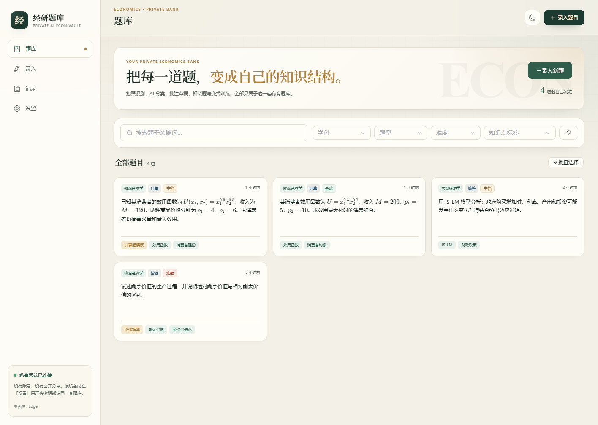

# 经济学考研私有 AI 题库

> 面向经济学考研学生的私有题库：拍照 OCR、AI 分类标签、批注与草稿纸、向量相似题、AI 变式训练、云端操作日志。
>
> **没有账号密码、手机号、邮箱、验证码。** 第一次访问自动生成 256-bit 设备 token；换设备用迁移密钥绑定同一套云端题库。



---

## 1. 整体架构

```text
┌─────────────────────────────────────────────────────────────┐
│ Cloudflare Pages（纯静态 SPA）                               │
│ Vue 3 + Element Plus + UnoCSS + KaTeX + Tesseract.js         │
│                                                             │
│ localStorage: 只保存 user_token + 主题                        │
│ 题目 / 批注 / 草稿 / 日志每次都从云端读取，清缓存不丢数据       │
└───────────────────────┬─────────────────────────────────────┘
                        │ HTTPS
        ┌───────────────┼───────────────────┐
        │               │                   │
        ▼               ▼                   ▼
┌──────────────┐ ┌──────────────┐ ┌──────────────────┐
│ Supabase     │ │ Supabase     │ │ Supabase Edge    │
│ PostgREST    │ │ pgvector RPC │ │ Function: ai     │
│ 4 张核心表   │ │ 相似题检索   │ │ 分类/向量/变式    │
│ RLS + token  │ │ RLS          │ │ anon key 验 token │
└──────┬───────┘ └──────┬───────┘ └────────┬─────────┘
       │                │                  │
       └────────────────┴──────────────────┘
                        │
                 ┌──────▼───────┐
                 │ Supabase     │
                 │ PostgreSQL   │
                 │ extensions.  │
                 │ vector(1024) │
                 └──────────────┘
```

### 无登录隔离模型

- 浏览器用 `crypto.getRandomValues(32 bytes)` 生成 `ut_...` token，存 `localStorage`。
- Supabase JS 的全局 `fetch` 给每个 PostgREST/RPC 请求加：

```http
x-user-token: ut_...
```

- RLS 从 PostgREST 的 `request.headers` 读取 token：

```sql
user_token = current_setting('request.headers', true)::jsonb ->> 'x-user-token'
```

- 所有表都有 `user_token`，RLS 只允许当前 token 的行；没有 token 返回空/拒绝。
- 设备指纹只作为 `user_set` 的设备标识和日志辅助，**不作为唯一凭证**，避免指纹碰撞导致串库。
- 迁移密钥 `mk_...` 与 token 分离；新设备调用 `redeem_migration_key(mk_...)` 换回 token，再写入 localStorage。

> 安全边界：token 是 bearer credential。拿到 token 或迁移密钥的人拥有该题库访问权。这是“无账号 + 多端互通”的必然取舍。

---

## 2. 功能清单

| 模块 | 已实现 |
| --- | --- |
| 拍照 / 相册 | `<input capture="environment">` + 文件选择；图片压缩 |
| OCR | Tesseract.js `chi_sim+eng`，自动拆 A/B/C/D 选项，可人工校对 |
| 题目编辑 | 题干、动态选项、答案、解析、学科/题型/难度、标签、LaTeX 预览 |
| AI 分类 | Edge Function + OpenAI-compatible chat；无 key 自动本地关键词降级 |
| AI 标签 | 自动生成知识点标签，支持人工增删改；另有手动标签 |
| 题库管理 | 卡片、分页、学科/题型/难度/标签筛选、题干关键词搜索 |
| 删除 | 单题软删除、当前页批量删除；日志保留 |
| 批注 | 一题多条批注，新增/编辑/删除，云端保存 |
| 草稿纸 | Canvas 手写、画笔、直线、矩形、椭圆、橡皮、撤销、清空、颜色/粗细、自动保存 |
| 相似题 | pgvector cosine，仅在当前 token 自己的题库内检索 |
| 变式训练 | 1–5 道，难度降低/不变/提升；预览后保存到题库 |
| 操作日志 | 9 类必需操作 + AI 分类/迁移；倒序、筛选、分页；不可删改 |
| 多端 | 同一 token/迁移密钥刷新即可看到最新数据 |
| 迁移 | 设置页显示/复制迁移密钥，新设备导入 |
| 主题 | 深色/浅色，移动端底部导航 |
| 图片存储 | 全局默认 + 单题开关：只存 OCR 文字 / 云端保存压缩原图 |

---

## 3. 技术选型

- **前端**：Vue 3、Vite 6、Vue Router、Pinia、Element Plus、UnoCSS
- **公式**：KaTeX + marked + DOMPurify
- **OCR**：Tesseract.js 5（浏览器本地识别；语言包/worker 从 CDN 加载）
- **后端**：Supabase PostgreSQL、PostgREST、RLS、pgvector、Edge Functions
- **AI**：OpenAI-compatible Chat + Embeddings（默认 DeepSeek chat + BAAI/bge-m3 1024 维）
- **部署**：Cloudflare Pages（静态）

没有引入账号系统、社交、分享、评论、排行榜、支付或外部题库抓取。

---

## 4. 目录结构

```text
econ-ai-bank/
├── index.html
├── package.json
├── pnpm-lock.yaml
├── vite.config.js
├── uno.config.js
├── public/_redirects
├── src/
│   ├── main.js
│   ├── App.vue
│   ├── router/index.js
│   ├── stores/user.js
│   ├── lib/
│   │   ├── supabase.js        # 动态 x-user-token fetch
│   │   ├── session.js
│   │   ├── device.js          # 随机 token + 轻量设备指纹
│   │   ├── constants.js
│   │   ├── format.js
│   │   ├── ai.js              # Edge AI 调用 + 降级
│   │   ├── local-ai.js        # 本地分类 / hashed 1024 向量
│   │   ├── ocr.js             # 压缩 / Tesseract / 选项解析
│   │   └── questions.js       # 表 / RPC / 日志 API
│   ├── components/
│   │   ├── AppShell.vue
│   │   ├── MathText.vue
│   │   ├── QuestionCard.vue
│   │   ├── DraftCanvas.vue
│   │   ├── VariantDialog.vue
│   │   └── EmptyState.vue
│   ├── views/
│   │   ├── BankView.vue
│   │   ├── EditorView.vue
│   │   ├── DetailView.vue
│   │   ├── LogsView.vue
│   │   └── SettingsView.vue
│   └── styles/main.css
├── supabase/
│   ├── config.toml
│   ├── migrations/20261112000000_econ_ai_bank.sql
│   ├── functions/ai/index.ts
│   └── .env.functions.example
└── docs/
    ├── ARCHITECTURE.md
    ├── DATABASE.md
    ├── API.md
    ├── DEPLOYMENT.md
    ├── SECURITY.md
    └── screenshots/
```

---

## 5. 本地运行

```bash
cd econ-ai-bank
pnpm install
cp .env.example .env
# 填 VITE_SUPABASE_URL / VITE_SUPABASE_ANON_KEY
pnpm dev
```

打开 `http://localhost:5175`。首次访问自动创建 token 与 `user_set`，无需注册。

构建：

```bash
pnpm build
pnpm preview
```

---

## 6. Supabase 初始化

1. 新建 Supabase 项目。
2. SQL Editor 执行 [迁移 SQL](supabase/migrations/20261112000000_econ_ai_bank.sql)。
3. **Database → Extensions** 确认 `vector`、`pg_trgm`、`pgcrypto` 已启用（SQL 也会创建）。
4. **Project Settings → Data API** 确认 `public` schema 和四张表对 Data API 暴露（2026 年后新项目默认不再自动暴露，需在 Data API 设置中显式开启）。
5. **Project Settings → API** 记录 URL 与 `anon public` key。
6. 本地 `.env` / Cloudflare 环境变量填入。
7. 不需要创建 Auth 用户、不需要开启 Email/Phone/OAuth、不需要配 Storage bucket。
8. 部署 AI Edge Function、配置 secrets（见下）。

### 自托管 CORS 注意

Supabase Cloud 默认允许自定义请求头。若你是自托管 Supabase，需要在 Kong/Envoy 的 CORS 允许头中加入：

```text
x-user-token
```

否则浏览器预检会拦截。详见 [DEPLOYMENT.md](docs/DEPLOYMENT.md)。

---

## 7. AI Edge Function

```bash
supabase login
supabase link --project-ref YOUR_PROJECT_REF
supabase functions deploy ai --no-verify-jwt

supabase secrets set \
  AI_CHAT_BASE_URL=https://api.deepseek.com/v1 \
  AI_CHAT_API_KEY=YOUR_CHAT_KEY \
  AI_CHAT_MODEL=deepseek-chat

supabase secrets set \
  AI_EMBEDDING_BASE_URL=https://api.siliconflow.cn/v1 \
  AI_EMBEDDING_API_KEY=YOUR_EMBEDDING_KEY \
  AI_EMBEDDING_MODEL=BAAI/bge-m3
```

可选：

```dotenv
AI_ALLOWED_ORIGIN=https://your-project.pages.dev
```

- Chat 用于分类、变式；Embedding 用于相似题。
- **Embedding 必须是 1024 维**，和 SQL 的 `vector(1024)` 一致。
- 没有 AI key 时：分类/向量自动用本地降级；变式会提示先配置。
- 模型 key 只在 Edge secrets；前端没有 key，也没有 service_role。

---

## 8. Cloudflare Pages 部署

| 配置 | 值 |
| --- | --- |
| Build command | `pnpm build` |
| Build output | `dist` |
| Node | 20+ |
| 环境变量 | `VITE_SUPABASE_URL`、`VITE_SUPABASE_ANON_KEY` |
| SPA fallback | `public/_redirects` 已包含 |

把仓库推到 GitHub/GitLab 的 `main`，Cloudflare Pages 连接仓库即可。详细步骤见 [DEPLOYMENT.md](docs/DEPLOYMENT.md)。

---

## 9. 页面路由

| 路由 | 页面 | 功能 |
| --- | --- | --- |
| `/bank` | 题库首页 | 搜索、筛选、分页、批量删除 |
| `/questions/new` | 录入题目 | 拍照/文件 OCR、AI 分类、编辑保存 |
| `/questions/:id` | 题目详情 | 完整题目、批注、草稿、相似题、变式 |
| `/questions/:id/edit` | 编辑题目 | 修改题干/答案/标签/图片 |
| `/logs` | 操作记录 | 倒序日志、类型筛选、不可删除 |
| `/settings` | 设置与迁移 | 迁移密钥、原图策略、主题、设备信息 |

---

## 10. 核心 API

### 表（PostgREST）

| 表 | 用途 |
| --- | --- |
| `user_set` | token / 迁移密钥 / 设备 / 原图策略 |
| `question` | 题目、选项、答案、解析、标签、向量、图片 |
| `question_note` | 一题一行；多条批注 JSON + 草稿 base64 |
| `operation_log` | 不可篡改的操作日志 |

### RPC

| RPC | 作用 |
| --- | --- |
| `redeem_migration_key(p_key)` | 迁移密钥换回 user_token |
| `match_questions_for_question(question_id, limit)` | 当前 token 库内 cosine 相似检索 |
| `list_question_tags()` | 当前 token 的全部标签 |

### Edge Function

| action | 输入 | 输出 |
| --- | --- | --- |
| `classify` | stem/options/answer/analysis | subject/type/difficulty/knowledge_tags |
| `embed` | text | 1024 维 embedding |
| `variants` | 原题 + count + difficultyMode | 1–5 道变式 |

完整请求/字段说明见 [API.md](docs/API.md)。

---

## 11. 数据持久化与 1000+ 题

- 所有题目/批注/草稿/日志都在 PostgreSQL；本地只存 token/主题。
- 题目软删除（`deleted_at`），没有 TTL/定时清理；批注/草稿/日志无自动删除。
- 列表分页（默认 12/页），只拉卡片字段；详情单独拉图片/全文。
- 索引：`(user_token, created_at)`、学科/题型/难度、标签 GIN、题干 trigram GIN、向量 HNSW。
- 图片默认 `text_only`；如全量保存原图，注意数据库容量，1000+ 题建议只存文字或按需保存。

---

## 12. 已知限制

- 没有密码找回。token/迁移密钥丢失 = 无法访问；这是无账号设计的代价。
- 迁移密钥/ token 是 bearer secret，泄露即泄露题库。
- 相似题的质量取决于 embedding 模型；默认 BGE-M3，未配置时是本地 hashed 词法向量。
- OCR 依赖 Tesseract CDN 网络；首次加载中英文模型约数 MB。
- 图片以 base64 存在 `question.image_data`，不是对象存储；大量原图会占用数据库。
- 没有实时推送；其他设备刷新页面/重新进入页面即可看到最新数据（符合需求）。
- 浏览器隐私模式/清除站点数据会丢 token，需要迁移密钥恢复。

---

## 13. 文档

- [架构说明](docs/ARCHITECTURE.md)
- [数据库表结构](docs/DATABASE.md)
- [接口设计](docs/API.md)
- [部署步骤](docs/DEPLOYMENT.md)
- [安全模型](docs/SECURITY.md)
- [SQL 迁移](supabase/migrations/20261112000000_econ_ai_bank.sql)
- [AI Edge Function](supabase/functions/ai/index.ts)
